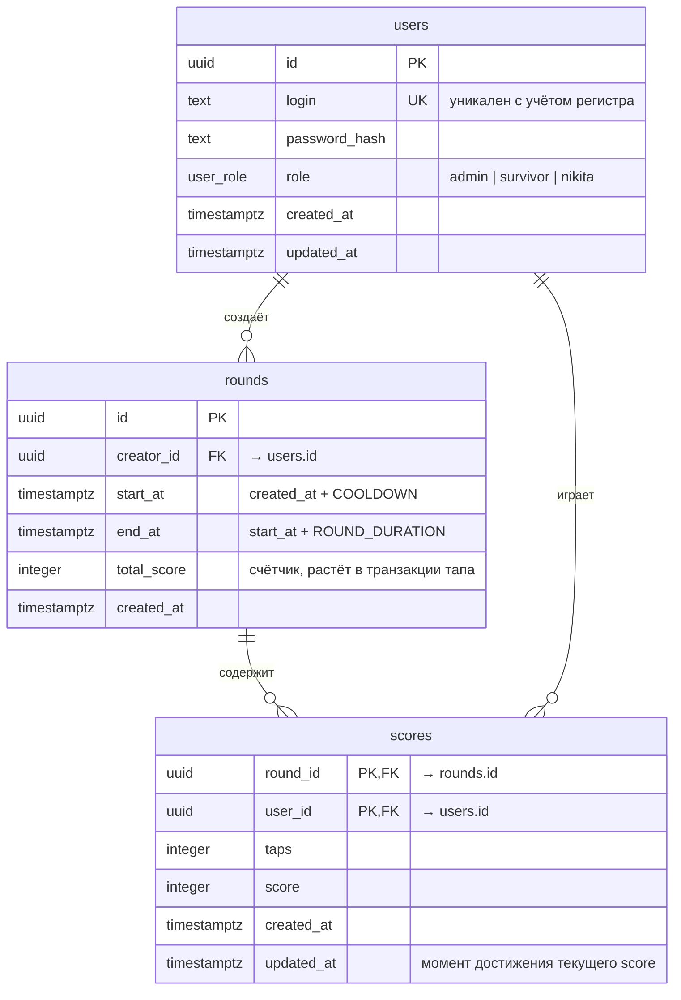

# The Last of Guss

## Запуск

Нужны Node 22 и Docker. Команды выполняются из корня репозитория.

Postgres:

```bash
docker compose up -d postgres
```

Бэкенд:

```bash
cd backend
cp .env.example .env
cp .env.test.example .env.test
npm ci
npm run migration:run
npm run start:dev
```

Вместо `npm run start:dev` можно собрать и запустить продовую сборку (из `backend/`):

```bash
npm run build
node dist/index.js
```

API: http://localhost:3000, Swagger: http://localhost:3000/api/docs

Фронтенд (в другом терминале):

```bash
cd frontend
cp .env.example .env
cp .env.test.example .env.test
npm ci
npm run dev
```

Игра: http://localhost:5173

Как попробовать: войти под `admin` (пользователь создаётся при первом входе, пароль от 6 символов), создать раунд, во втором браузере или в окне инкогнито войти под другим именем и тапать.

## Схема БД


